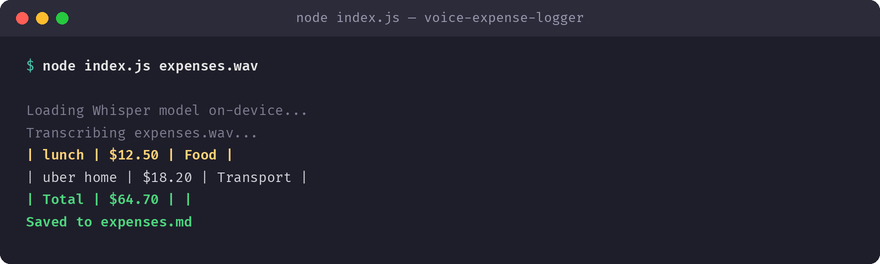

# voice-expense-logger

Transcribes spoken expenses and turns them into a categorized expense table, on-device. Built with [Tether's QVAC SDK](https://github.com/tetherto/qvac) — the model runs on-device, so nothing leaves your machine.

## What it does

Transcribes spoken expenses and turns them into a categorized expense table, on-device.

**QVAC functions used:** `loadModel`, `transcribe` and `completion`.



## Why I built it

I'll say 'twelve bucks lunch' out loud. I will never open a spreadsheet at lunch.

## Requirements

- Node.js >= 22
- `@qvac/sdk` `^0.19.0` (installed automatically via `npm install`)

## Install

```bash
git clone https://github.com/nafred001-code/voice-expense-logger.git
cd voice-expense-logger
npm install
```

## Run

```bash
node index.js path/to/expenses.wav
```

See the comments at the top of `index.js` for the exact input this app expects. On first run, QVAC downloads the model it needs once and caches it locally; every run after that is fully offline.

## SDK version used

`@qvac/sdk` `0.19.1`

## License

MIT — see [LICENSE](LICENSE).
